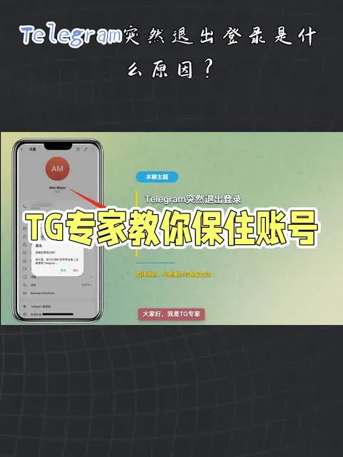

在隐私保护日益重要的今天，很多用户在注册 Telegram（电报）时，会担心真实的手机号被泄露或遭受骚扰。为了规避这种风险，或者为了在某些特定场景下快速加入群组、进行临时性测试，获取一个“tg临时账号”成为了很多人的首选。然而，临时账号的使用并非像注册普通账号那样简单，如果操作不当，极易面临被封号或数据丢失的风险。

## 什么是tg临时账号及其核心使用场景

简单来说，tg临时账号是指使用非实名手机号或通过虚拟接码平台注册的 Telegram 账号。这种账号的核心价值在于“匿名性”，让用户在不暴露真实身份信息的情况下完成社交。

通常，用户对临时账号的需求集中在以下几个场景：
1. **隐私隔离**：在加入一些信息杂集的公共群组时，防止自己的手机号出现在通讯录中导致被标记。
2. **功能测试**：开发者在测试机器人（Bot）或自动化脚本时，不需要消耗自己的主号。
3. **临时社交**：在某些一次性的社交活动中，使用完后直接注销或弃用账号。
4. **规避风控**：避免主账号因为频繁进出群组或敏感操作被系统临时限制。

## 获取tg临时账号的常见途径对比

目前市面上获取临时账号的方式主要分为三种，每种方式在稳定性和成本上都有差异。

### 1. 虚拟接码平台

这是目前最常见的获取方式。这类平台提供全球各地的虚拟手机号，用户支付小额费用租用号码来接收短信验证码完成注册。
 **优点**：成本极低，获取极快。
 **缺点**：号码通常是共用的，一旦租用过期，账号可能被他人分配，且在没有开启二次验证的情况下，账号无法找回。
2. 实体海外流量卡（实体号）

购买特定国家地区的实体流量卡（如英国、美国或亚洲部分国家）来注册账号。
 **优点**：稳定性最高，号码私有，不容易被他人接管，且适合长期使用。
 **缺点**：成本较高，且需要具备一定的海外操作能力。
3. Telegram 官方匿名号码（Fragment）

Telegram 官方推出了基于区块链的匿名号码服务（基于 Fragment）。
 **优点**：官方支持，无需实体手机卡，完全匿名，所有权归数字钱包所有。
 **缺点**：需要购买 TON 代币，价格波动较大，对普通用户门槛较高。
为什么注册的tg临时账号经常被封禁

很多用户在获取了临时账号后，发现发现刚用几天就提示“此号码已被封禁”。这通常是由于 Telegram 严苛的风控机制导致的。

- **号段权重问题**：虚拟接码平台提供的号段往往被大量用户注册过，系统会将这些号段标记为高风险，导致注册即封。

- **操作过于频繁**：新号注册后立即加入大量活跃群组、发送大量消息或频繁修改头像，会触发系统的反垃圾邮件机制。

- **IP 环境不干净**：如果使用的代理服务器（VPN）被大量恶意用户共享，那么该 IP 下的账号极易被连封。

- **未开启安全防护**：没有设置双重验证（2FA）的临时账号在系统眼中是易受攻击的，权重也较低。

## 如何提高tg临时账号的存活率

如果你已经拥有了一个临时账号并希望它能稳定使用一段时间，以下几项操作是至关重要的：

### 立即开启两步验证（TwoStep Verification）

这是最重要的一步。在“设置”->“隐私与安全”->“两步验证”中设置一个复杂的密码。这样即使别人通过接码平台再次获取了你的验证码，没有密码也无法登录你的账号。

### 完善隐私设置

在“隐私与安全”选项中，进行以下调整：
 **手机号**：设置为“没有人”。
 **谁能看到我的电话**：设置为“我的联系人”。
 **转发消息时链接我的账号**：设置为“没有人”。

这样可以有效防止他人通过你的聊天信息反查你的账号身份。

### “养号”策略

新注册的账号不要急着使用。建议先像真人一样，设置头像、个人简介，保持几天活跃，后再尝试加入一两个高质量的群组。让系统认为你是一个真实的普通用户，而非自动化脚本。

## 临时账号使用中的风险防范

虽然临时账号能保护隐私，但它并非绝对安全，在使用时需要警惕以下风险：

1. **数据丢失风险**：如果你使用的是虚拟接码平台，一旦平台下线或号码被回收，你所有的聊天记录、群组数据都会丢失。因此，**不要在临时账号中存储任何重要私密**。
2. **诈骗风险**：在购买临时账号的过程中，会有很多号称“永久不封”或“包售后”的骗子。请务必选择信誉良好的平台，避免大额转账。
3. **账号接管风险**：如果未开启两步验证，接码平台的号码被再次使用后，你的账号可能会被他人登录。

## 不同类型临时账号的特性对比表

| 类型 | 稳定性 | 成本 | 匿名性 | 适用场景 |
| :--- | :--- | :--- | :--- | :--- |
| **虚拟接码号** | 低 | 极低 | 中 | 临时测试、快速进群 |
| **实体海外卡** | 高 | 高 | 高 | 长期使用、核心社交 |
| **Fragment 匿名号** | 极高 | 波动 | 极高 | 资产存储、深度隐私需求 |

## 总结建议

获取tg临时账号是解决隐私焦虑的有效工具，但前提是用户必须理解其局限性。如果你是为了长期稳定地作为主要社交工具，建议投入成本购买实体海外卡或使用官方匿名号；如果你只是为了临时进入某个频道，选择可靠的虚拟接码平台并务必开启两步验证，就能满足基础的需求并确保安全。
