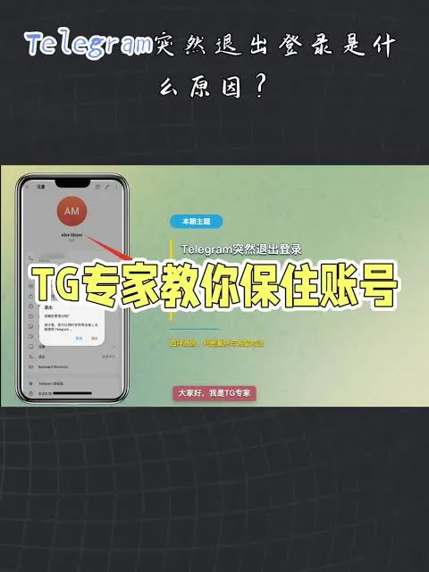

在开始使用 Telegram（简称电报）时，很多新用户都会产生一个困惑：tg登录需要收费吗？在注册过程中是否需要支付短信费用？或者登录时是否存在隐藏的？由于该工具的特殊性以及网络环境的影响，很多用户在操作过程中会遇到各种提示。

简单直接的回答是：Telegram本身的账号注册、登录以及基础聊天功能是免费的。但在实际使用过程中，某些特定的场景或特定的网络环境下，确实会产生费用开支。为了让大家避开坑，本文将从登录机制、验证码成本、高级功能以及可能遇到的额外费用等多个维度进行深度解析。

## Telegram基础注册与登录是完全免费的

Telegram 的定位是一个全球性的免费即时通讯工具。无论你是使用 iOS 版、Android 版，还是电脑客户端，下载应用并尝试登录时，Telegram 官方不会向用户收取任何“入门费”。

当你输入手机号进行注册申请时，系统会发送一个验证码。只要你成功获取验证码，就可以正常开始发送消息、进行语音通话、创建群组或频道。这些功能都是不需要付费的。因此，如果你在某些非官方平台看到要求支付“登录费”才能进入账号，那极大概率是诈骗。

## 为什么有人会觉得tg登录需要收费？

虽然登录本身不收费，但“获取验证码”这个环节往往会导致产生开支，这是绝大多数用户产生“tg登录需要收费”错觉的原因。

### 1. 国际短信流量费

默认情况下，Telegram 会通过短信发送验证码。由于 Telegram 是国外的服务，如果你的手机运营商不支持国际短信接收，或者开启了国际短信功能，接收验证码可能会产生额外的短信费用。这笔钱是交给手机运营商的，而不是 Telegram 官方。

### 2. 虚拟号码购买成本

为了保护隐私，很多用户选择不使用实体手机号注册，而是通过第三方平台购买虚拟号码（如接码平台或海外手机卡）。购买这些号码通常是需要付费的。虽然这属于购买账号媒介的费用，但对于用户来说，这是为了登录而必须的成本。

### 3. 验证码收不到的变相成本

在某些地区，由于运营商拦截或网络波动，用户经常遇到收不到短信验证码的情况。这时，用户可能会尝试使用付费的接码服务或购买更稳定的海外实体 SIM 卡来解决问题。这种为了解决登录障碍而产生的支出，间接增加了登录的成本。

## Telegram Premium 会员服务的收费项

虽然基础功能免费，但 Telegram 近年来推出了 Premium 会员订阅服务。这是目前官方唯一的付费项目，但它并不影响你正常登录，而是提供功能上的扩展。

如果你订阅了 Premium，你将获得以下特权：
 **更高的额度限制**：例如更多的群组数量、频道订阅、文件夹分类等。
 **下载速度加速**：下载大文件时不再受限速。
 **专属表情与标识**：可以使用会员专属的动态表情包和头像标识。
 **语音转文字功能**：可以将语音消息实时转为文字方便阅读。
 **无广告干扰**：在某些频道中不再看到底部推广广告。

对于大多数普通用户来说，这些功能并非强制性，不购买 Premium 完全不影响你登录和使用核心聊天功能。

## 登录时可能遇到的异常与非官方陷阱

在尝试登录时，用户可能会遇到一些看似“收费”或“报错”的情况，需要学会辨别：

### 频繁尝试导致“Too Many Attempts”

如果你在短时间内多次输入错误验证码或频繁切换登录设备，系统会提示“Too Many Attempts”。这是一种安全保护机制，并不是收费。解决办法通常是等待几小时甚至更久后再试，千万不要轻信任何所谓的“付费解锁登录限制”的第三方工具。

### 虚假登录页面的诈骗

网络上充斥着许多所谓的“Telegram 网页版登录”镜像网站。这些网站可能会要求你输入手机号和验证码，甚至要求你支付小额费用以激活账号。请务必只通过官方客户端或官方域名进行登录，否则会导致账号直接被盗取。

## 如何降低登录时的额外成本？

为了避免在登录过程中产生不必要的费用，建议采取以下操作：

1. **优先使用设备端验证码**：如果你已经在手机上登录了 Telegram，在电脑或其他设备上登录时，验证码会直接发送到旧设备的 Telegram App 消息内，而不是通过短信。这种方式是完全免费且最安全的。
2. **开启两步验证（2FA）**：登录成功后，务必在设置中开启两步验证并设置独立密码。这样即使你的短信验证码被截获，他人也无法登录你的账号，避免了账号被盗后的找回成本和风险。
3. **使用稳定的网络环境**：网络不畅会导致验证码请求失败，从而导致用户反复尝试，触发频率限制或增加流量浪费。

总结来说，**tg登录本身并不需要收费**。Telegram 官方提供的基础服务是免费的。你所感知到的费用通常源于：国际短信费、虚拟号码购买费、或者是对高级 Premium 功能的主动订阅。只要坚持通过官方渠道操作，警惕任何非官方的收费登录请求，就可以安全、免费地使用这款工具。
