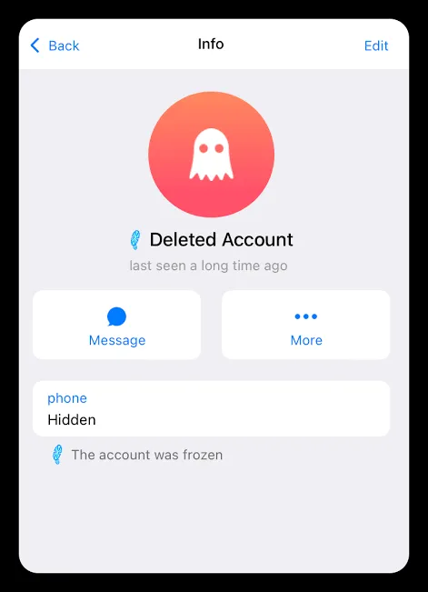
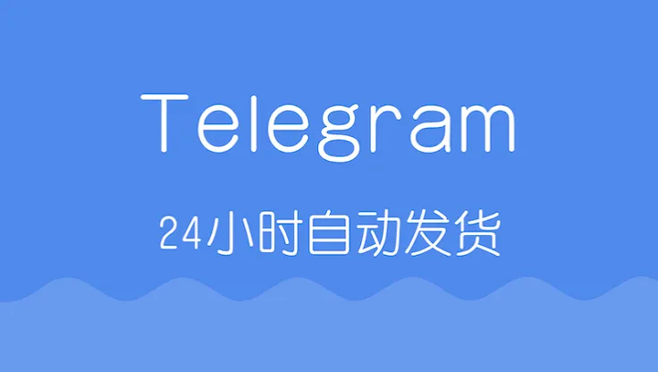

在如今社交工具碎片化的时代，Telegram（简称电报）凭借其极高的隐私性和强大的群组功能成为了许多人的首选工具。然而，由于注册限制的不断收紧，很多用户在尝试注册时会遇到手机短信收不到、IP被封或频繁封禁等问题。这导致“tg账号成品号”成了一个刚需市场。但市场上的成品号鱼龙混杂，新手如果不了解相关门道，很容易在购买后遭遇被封、被找回甚至导致个人信息泄露的风险。如何选择优质的成品号？购买后又如何保障账号安全？这是每一位用户都需要深度了解的课题。

## 什么是tg账号成品号以及它的常见类型

简单来说，tg账号成品号是指已经完成注册流程、可以直接登录的账号。与用户自己用手机号注册的账号不同，成品号跳过了等待验证码的繁琐步骤，即买即用。

目前市面上常见的成品号主要分为以下几类：

1. **虚拟号成品号**：这类账号通常通过国外的虚拟手机平台注册。优点是价格低廉，缺点是稳定性较差，一旦虚拟平台收回号码，账号就极易无法登录。
2. **实体卡成品号**：使用真实的实体SIM卡（如英国卡、美国卡、亚洲卡等）注册。这种账号权重较高，最不容易被系统判定为异常，价格也相对昂贵。
3. **老号（高权重号）**：指注册时间较远的账号。在Telegram的算法中，注册时间越长的账号权重越高，在加入大型群组或发送信息时越不容易触发风控机制。
4. **带功能的成品号**：这类账号可能已经设置好了头像、用户名、简介，甚至已经加入了某些频道，适合那些需要直接进行业务运营的用户。

用户需要根据自己的使用场景（如是个人私聊、社群营销、还是作为主号使用）来选择合适的类型。

## 购买电报成品号前需要确认的几个核心信息

很多新手在购买时只看价格便宜，这往往是“踩坑”的开始。在下单之前，请务必向卖家确认以下四个关键信息：

### 账号的注册环境与地区

你需要明确账号是哪个国家或地区的注册。不同地区的账号在风控策略上存在差异。例如，某些地区的号段由于注册量巨大，容易被标记为垃圾账号，而冷门地区的号段往往相对稳定。

### 对应的类型

一定要问清楚是实体号还是虚拟号。如果是为了长期使用，建议务必选择实体卡成品号。虚拟号一旦出现欠费或号码回收，账号几乎无法找回。

### 账号当前的状态

确认账号是“活号”。有些卖家会出售已经处于某种半封禁状态的“灰号”。最好要求卖家提供近期的测试反馈，确保账号在登录后没有立即触发验证或封禁。

### 登录凭证的完整性

完整的成品号应该提供：手机号、验证码、以及最重要的二步验证密码（2FA）。如果卖家没有设置二步验证，你登录后第一时间必须自行开启。

## 为什么我买的成品号登录后会被封禁？

很多用户买了tg账号成品号后，发现没几天就提示被封，这通常不是账号本身的问题，而是操作不当触发了风控。

1. **IP环境切换频繁**：这是最常见的原因。如果你在登录时频繁在不同的国家、地区IP之间切换，Telegram系统会认为该账号被盗用，从而导致自动封禁。
2. **操作过于激进**：新号登录后，立即加入大量活跃群组、向大量陌生人发送私信或频繁在群发言，这些行为会被算法识别为垃圾邮件营销。
3. **设备指纹问题**：在同一台设备上频繁登录多个被封账号，会导致该设备被列入黑名单，后续登录的新号也会连带。
4. **未开启二步验证**：如果账号本身没有开启二步验证，卖家或第三方可能通过手机号权限随时找回账号，导致你的数据瞬间丢失。

## 拿到tg账号成品号后的标准安全操作流程

拿到账号后，千万不要急着就开始聊天。为了确保账号的长久使用，请严格按照以下步骤操作：

### 第一步：立即开启二步验证（2FA）

这是重中之重。进入 `Settings` -> `Privacy and Security` -> `Two-Step Verification`。设置一个复杂的密码，并绑定一个你自己的常用电子邮箱。这样，即使别人拿到了你的手机号，没有这个密码也无法登录你的账号。

### 第二步：完善隐私设置

在 `Privacy and Security` 中，将“手机号（Phone Number）”、“最后在线时间（Last Seen）”、“头像（Profile）”等全部设置为“Nobody”或“My Contacts”。这可以极大减少被陌生人举报的概率。

### 第三步：固定网络环境

选择一个稳定的科学上网工具，并尽量在同一个地区、同一个节点下长期使用。不要在通勤途中或在不稳定的网络环境下频繁切换节点。

### 第四步：缓慢“养号”

新号登录后的前几天，建议像正常人一样使用。先和几个朋友发信息，加入一两个不活跃的频道，不要急着私信陌生人或群发信息。让系统认为你是一个真实的活跃用户。

## 如何规避成品号交易中的常见陷阱？

在寻找tg账号成品号的渠道时，要保持警惕。以下是常见的陷阱：

- **极低价陷阱**：价格远低于市场价的账号，通常是批量注册的“一次性号”，或者是根本没有售后保障的劣质。

- **无售后承诺**：靠谱的卖家通常会提供一定的“售后期”（例如登录后24小时内封禁包补）。如果卖家明确一概不负责，建议直接绕道。

- **要求提供敏感信息**：任何要求你在购买前预先提供个人支付支付或其他或其他隐私隐私的卖家，都是骗子。

总结来说，tg账号成品号虽然能解决注册的痛点，但它本身是一把双刃剑。通过合理的筛选（优先实体老号）、严格的后期设置、以及科学的养号习惯，才能在Telegram的世界里获得稳定、安全的使用体验。
