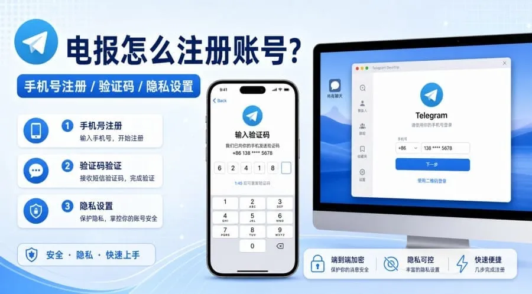
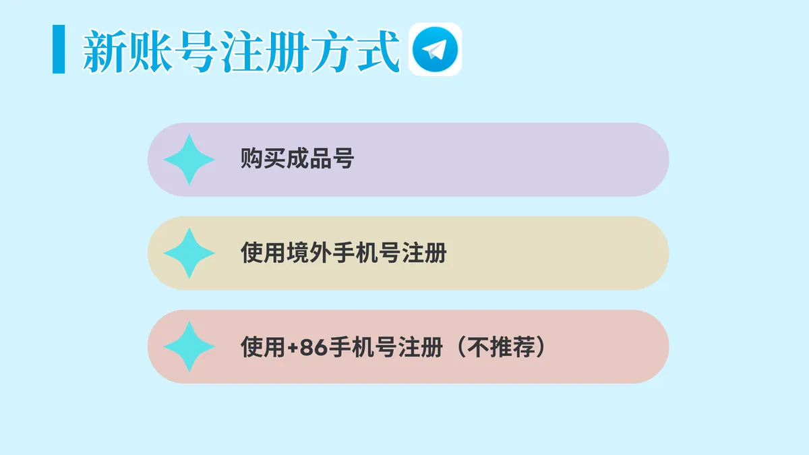
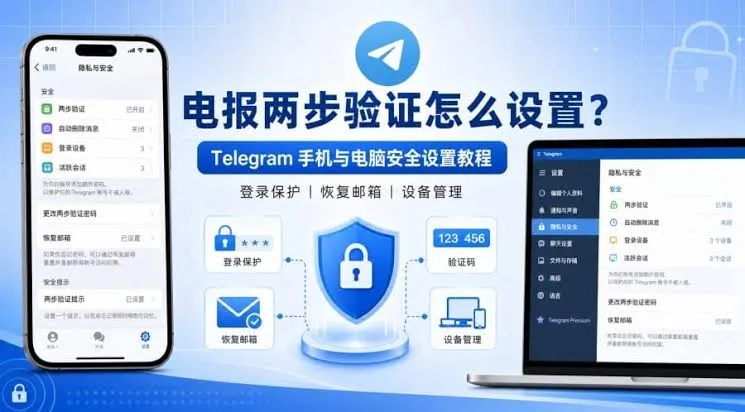

在很多人的需求中，Telegram（简称电报）是获取信息、加入社群的重要工具。然而，由于注册限制、手机号收不到验证码等问题，很多用户会选择“便宜tg账号购买”这种方式。市场上的账号种类繁，价格也良差不齐，如果仅仅盯着低价看，很容易买到频繁被封禁或无法登录的垃圾号。为了让大家在交易时少走弯路，了解不同账号背后的逻辑、风险以及选择的技巧至关重要。

## 为什么会有不同价格的电报账号？

在寻找便宜tg账号购买时，用户会发现价格从几块钱到不等。这种价格差异主要源于账号的来源、注册环境以及账号的“权重”。

低价的账号通常是批量注册的虚拟号，它们通过网络接码平台生成，成本极低，但缺点是稳定性极差，一旦平台回收手机号，或者系统检测到是虚拟号，账号就会瞬间失效。而价格稍高的账号通常使用实体手机卡（如物理卡）注册，这类账号具有真实的设备属性，稳定性远高于。此外，账号的“年龄”也是影响价格的关键，注册时间并存活很久的“老号”比新注册的号更不容易触发风控。

## 常见的电报账号类型对比

在购买之前，你必须明确自己需要的是哪种类型。市面上常见的类型主要分为以下几类：

### 1. 注册号（成品号）

这种账号是已经注册好的，你购买后直接获取账号和密码即可登录。优点是即买即用，不需要等待验证码；缺点是你无法控制账号的注册环境，如果原主操作违规，你买后可能秒封。

### 2. 虚拟号账号

通过网络短信接码平台注册的账号。这类账号通常是便宜tg账号购买的首选，但由于虚拟号段是共用的，一旦别人再次尝试注册，你的账号就会被挤掉，不建议用于存放重要信息的数据。

### 3. 实体卡账号

使用真实的物理SIM卡注册的账号。这种账号的安全性最高，不容易因为环境问题被封禁。如果你是为了长期使用或需要加入某些群组，实体卡账号是更好的选择。

### 4. 带权重号（老号）

这类账号已经注册了较长时间，且有一定的活跃记录。系统对这类账号的容忍度更高，不容易被限制。

| 账号类型 | 稳定性 | 价格 | 适用场景 |
| :--- | :--- | :--- | :--- |
| 虚拟号 | 极 | 极低 | 临时注册、测试功能 |
| 注册号 | 中等 | 较低 | 批量加群、短期建号 |
| 实体卡号 | 高 | 较高 | 长期使用、核心社交 |
| 老号 | 极高 | 高 | 商业运营、高价值存储 |

## 寻找便宜tg账号购买时需要确认的核心信息

很多用户在追求便宜时忽略了基础信息的确认，导致金钱白费。在交易前，请务必确认以下几点：

- **账号状态**：询问是否是“正常可用”还是“被封禁状态”。有些商家提供的便宜号其实是已经被封掉的，买回来根本无法登录。

- **登录方式**：是支持手机号+密码登录，还是必须通过验证码登录？如果需要验证码登录，意味着你必须还能接收该手机号的短信，否则账号无法找回。

- **是否支持解绑**：这是最关键的一点。如果账号无法解绑原手机号，那么原主随时可以找回账号，你的数据将毫无安全。

- **地区属性**：不同国家的手机号权重不同。某些地区的号段在Telegram上的风控非常严格。

## 购买后常见的登录异常及解决方法

即便你找到了便宜tg账号购买渠道，登录时依然可能遇到各种问题。提前掌握解决方案可以避免挫败感。

### 登录时提示“Too many attempts”

这通常是因为你的IP地址被系统标记为异常，或者该账号短时间内尝试登录次数过多。解决方法是更换更稳定的网络环境，或者等待24小时后再尝试登录。

### 收不到验证码

如果你购买的是虚拟号，经常会出现收不到验证码的情况。这可能是因为接码平台的号码段失效了，或者Telegram拦截了该号段的短信。建议尝试联系商家更换，或者选择更高质量的账号。

### 账号登录后秒封

如果刚登录就显示“账号被封”，通常是因为该账号的注册环境不干净，或者该账号本身就在黑名单中。这种情况通常属于商家质量问题，应及时要求售后补发。

## 如何保障你购买的账号安全

无论你是以什么价格购买的账号，安全性的维护都取决于你自己。为了防止账号被二次盗用，登录后请务必执行以下操作：

1. **开启双重验证（2FA）**：这是最重要的一步。在设置-隐私与安全中开启两步验证，这样即使别人拿到了你的验证码，没有二级密码也无法登录你的账号。
2. **检查绑定的邮箱**：查看账号是否绑定了原主人的邮箱。如果有，立即解绑并绑定你自己的安全邮箱。
3. **设置隐私权限**：将手机号、最后在线时间、个人头像等设置为“联系人”或“无”，防止被骚扰或窃取信息。
4. **检查活跃设备**：在“设备”列表里是否有不属于你的登录设备。如果有，立即退出所有其他设备。

## 避开低价陷阱的建议

在进行便宜tg账号购买时，要警惕那些低得离谱的报价。如果一个价格远低于成本价，它极有可能是“钓鱼号”或者是已经被封掉的死号。

建议用户根据需求来购买：如果你只是为了临时进某个群组看一眼信息，选择便宜的虚拟号注册号即可；但如果你打算将其作为主要的社交工具，存储重要的业务数据，建议多投入预算购买高质量的实体卡号或老号。稳定性远比省下那几块钱要重要得多。
