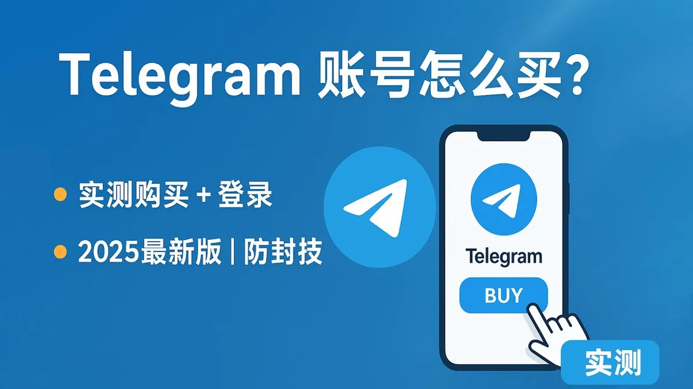

在Telegram里，你会看到很多频道和群组的链接格式像 `t.me/somechannel`，任何人都能通过这个链接找到并加入。这类账号就是Telegram公共账号——它的核心特征是拥有公开地址，对所有人可见，无需邀请即可访问。

但公共账号并不只有一种形式。频道、群组、Bot、用户资料都可能设置为公开，每种类型在功能、管理方式和适用场景上差异不小。下面把这些内容拆开讲清楚。

## 公共账号的几种类型

Telegram上的公共账号主要分为以下几类，它们虽然都共享"公开可见"这个特点，但运作逻辑完全不同。

### 公开频道

公开频道是最常见的公共账号形式。它的特点是单向广播——只有频道管理员能发消息，普通成员只能接收内容。频道成员数量没有上限，理论上可以容纳无限用户。

适合做资讯推送、公告发布、内容分发的场景。比如一个科技资讯频道每天推送行业新闻，或者一个电影资源频道定期更新资源链接。

### 公开群组

公开群组是双向互动的公共账号。所有成员都可以发言、分享文件、发起讨论。群组成员数量上限为20万人。

适合社区运营、兴趣交流、项目协作等需要成员互动的场景。一个编程学习群、一个游戏讨论组，都属于这类。

### 公开Bot

Bot是Telegram的自动化机器人账号，可以设置为公开。用户通过搜索Bot名称或直接访问其公开链接即可添加使用。

Bot通常用于提供自动服务，比如天气预报查询、内容分发、表单收集、支付处理等。一个公开Bot的链接格式通常是 `t.me/botname`。

### 公开用户资料

普通用户也可以把自己的个人资料设置为公开，这样别人通过搜索用户名就能找到你并添加好友。不过严格来说，用户资料更多是个人资料设置，不属于"账号运营"范畴。

## 公共账号和私密账号的核心区别

很多人第一次接触Telegram时会混淆公共账号和私密账号的概念。两者的区别主要体现在访问方式和可见性上。

| 对比维度 | 公共账号 | 私密账号 |
|---------|---------|---------|
| 访问方式 | 通过公开链接或搜索即可找到 | 需要邀请链接或管理员手动添加 |
| 搜索可见性 | 在Telegram搜索中可见 | 搜索不到，只有知道链接的人才能进入 |
| 成员上限 | 频道无上限，群组20万 | 频道无上限，群组20万 |
| 适用场景 | 内容分发、社区运营、品牌曝光 | 私密讨论、内部沟通、付费社群 |
| 管理难度 | 需要处理更多成员管理问题 | 相对简单，成员可控 |

公共账号的优势在于传播性强——用户通过搜索就能发现你，有利于扩大影响力。私密账号则适合需要控制成员范围的场景，比如付费社群、内部团队沟通等。

## 如何创建一个Telegram公共频道

创建公开频道的步骤很简单，但有几个细节需要注意。

**第一步：打开Telegram，点击新建频道。** 在手机端，点击右上角的编辑图标，选择"新建频道"；在桌面端，点击左侧菜单的铅笔图标，选择"新建频道"。

**第二步：设置频道名称和简介。** 名称要简洁明确，方便用户搜索和识别。简介部分可以写清楚频道提供什么内容、更新频率、加入方式等信息。

**第三步：选择公开或私密。** 在设置页面，选择"公开频道"，然后设置一个频道用户名（username）。这个用户名就是频道的公开链接地址，格式为 `t.me/你的用户名`。

**第四步：选择频道管理员。** 可以添加其他管理员协助管理频道。

**第五步：邀请成员或分享链接。** 创建完成后，把公开链接分享给你的目标受众，或者通过其他渠道推广。

设置用户名时有几个要点：

- 用户名一旦设置，在频道存续期间可以修改，但建议尽量保持稳定

- 用户名不能包含特殊字符，只能使用字母、数字和下划线

- 用户名是唯一的，已被占用的名称无法使用

- 建议用户名与频道名称保持一致，便于用户记忆

## 如何创建一个Telegram公共群组

公开群组的创建流程和频道类似，但功能设置有所不同。

创建群组后，在群组设置中找到"群组类型"选项，选择"公开群组"并设置用户名。公开群组的链接格式同样是 `t.me/群组用户名`。

公开群组相比私密群组，多了几个管理上的考量：

**成员管理**：公开群组任何人都可以加入，需要设置好入群规则。可以在群组设置中开启"成员邀请"功能，允许现有成员邀请新人，也可以关闭此功能仅允许管理员添加成员。

**发言权限**：公开群组默认所有成员都可以发言。如果希望控制发言权，可以在群组设置中调整权限，比如只允许管理员发言，或者设置发言频率限制。

**话题功能**：对于成员较多的公开群组，可以开启"话题"功能，将群组内容按主题分类，方便成员查找和讨论。

**防垃圾信息**：公开群组容易收到垃圾消息和机器人刷屏。建议开启群组过滤器，设置敏感词过滤，并定期清理异常成员。

## 公开Bot的创建和配置

如果你需要创建一个公开Bot，流程稍有不同，需要通过Telegram的BotFather来完成。

在Telegram中搜索 `@BotFather`，这是Telegram官方的Bot管理机器人。发送 `/newbot` 命令，按提示设置Bot名称和用户名。Bot的用户名必须以 `bot` 结尾，比如 `MyServiceBot`。

创建完成后，BotFather会给你一个API Token，这是Bot的认证密钥。你需要通过Telegram Bot API来配置Bot的功能，包括：

- 设置Bot的命令菜单（用户发送 `/start` 时显示的欢迎信息）

- 配置消息回复逻辑

- 设置Bot的头像和简介

- 连接后端服务实现自动化功能

公开Bot的链接会在Bot创建后自动生成，格式为 `t.me/你的Bot用户名`。任何用户都可以通过这个链接添加Bot。

## 公共账号的推广和增长

创建公共账号只是第一步，让更多人知道并加入才是关键。

**利用Telegram搜索**：公开账号的最大优势就是能被搜索到。设置好关键词相关的用户名和简介，当用户搜索相关内容时，你的账号就有机会出现在搜索结果中。

**内容质量**：频道和群组的内容质量直接决定用户留存率。定期更新、内容有价值、排版清晰，这些是留住成员的基础。

**跨平台推广**：在微博、微信公众号、知乎、小红书等平台发布内容时，附带Telegram公共账号的链接，引导用户加入。

**社群联动**：加入相关的公开群组或频道，在合适的时候分享你的账号信息。注意不要过度推广，避免被管理员移除。

**邀请奖励**：设置邀请奖励机制，鼓励现有成员邀请新用户加入。比如加入满一定人数后提供专属资源或福利。

## 公共账号运营中常见的问题

### 账号被举报或封禁怎么办

公共账号因为开放性强，更容易收到举报。常见举报原因包括发布违规内容、垃圾信息、侵权内容等。如果账号被临时限制，可以通过Telegram官方申诉渠道提交申诉，说明情况并提供证明。

如果账号被永久封禁，通常无法恢复。建议在日常运营中遵守Telegram的使用条款，避免发布违规内容。

### 如何保护公共账号不被恶意接管

公共账号的管理员权限非常重要。建议：

- 只添加信任的人作为管理员

- 开启管理员两步验证

- 定期检查管理员列表，移除不再活跃或不可信的管理员

- 开启频道或群组的"成员邀请"限制，避免陌生人通过成员邀请获得管理权限

### 公共账号的数据隐私问题

公共账号的成员信息是公开可见的，包括成员头像、用户名和成员数量。如果运营的是付费社群或需要保护成员隐私的场景，建议使用私密账号。

## 常见问题

**公共账号可以改成私密账号吗？**

可以。在频道或群组的设置中，将类型从"公开"改为"私密"即可。但要注意，改为私密后，之前的公开链接将失效，需要重新生成邀请链接。

**一个Telegram账号可以创建多个公共频道吗？**

可以。一个Telegram账号理论上可以创建无限数量的频道和群组，但实际使用中建议不要过多，以免管理困难。

**公共账号有成员数量限制吗？**

公开频道没有成员数量上限。公开群组的上限为20万人。超过这个限制后，需要转为频道或创建新群组。

**公共账号的链接可以修改吗？**

可以。在频道或群组的设置中，可以修改用户名（即公开链接）。但建议修改前通知现有成员，避免他们无法通过旧链接访问。

**如何查看公共账号的成员列表？**

频道成员列表默认对所有人可见。群组成员列表也默认公开。如果希望隐藏成员列表，可以将账号改为私密类型。

## 选择公共账号还是私密账号

最终选择哪种类型，取决于你的具体需求。

如果你需要做大范围的内容分发、品牌曝光、社区运营，公共账号是更好的选择。它的传播性强、容易被搜索到，有利于快速积累用户。

如果你需要控制成员范围、保护隐私、做付费社群或内部沟通，私密账号更合适。虽然传播性弱一些，但成员可控、隐私保护好。

两种类型也可以结合使用——用一个公开频道做内容分发和引流，同时运营一个私密群组做深度交流和付费服务。这种组合方式在Telegram运营中很常见。
