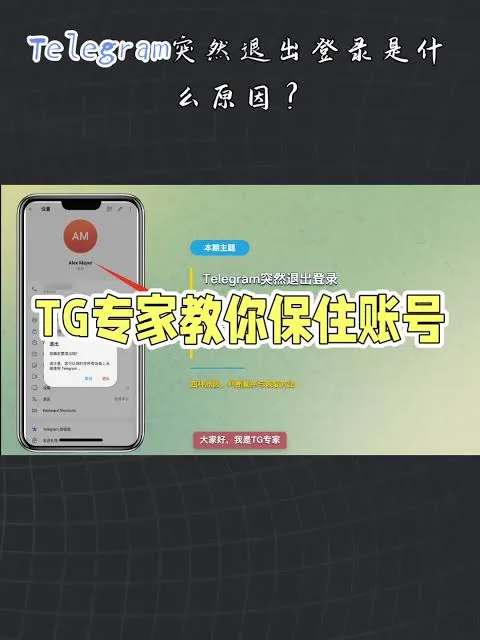

每次想下载Telegram，搜索结果里总混杂着各种第三方网站、破解版、修改版。点进去之后不是弹窗广告就是要求安装奇怪的应用。很多人搜"telegeram官方"，就是想找到一个干净、安全、没有风险的下载入口。

这篇文章把Telegram官方渠道说清楚——官网地址怎么记、官方应用在哪里下载、怎么判断自己拿到的是不是正版Telegram。

## 记住这个地址就够了

Telegram的官方网站是 **telegram.org**，这是唯一的官方域名。

访问方式很简单：打开浏览器，输入 telegram.org 或者 www.telegram.org，就能看到Telegram的官方首页。首页会直接显示各平台的下载按钮——Android、iOS、Windows、macOS、Linux、Web版，全部集中在这里。

如果你不确定自己访问的是不是官网，检查地址栏。官方域名只有一个：**telegram.org**。任何带有其他后缀、子域名、或者拼写变体的地址，都不是官方渠道。

### 官方首页能做什么

打开 telegram.org 之后，除了下载应用，还能做这些事：

- **注册新账号**：点击"Sign Up"即可开始注册流程

- **登录已有账号**：点击"Log In"输入手机号登录

- **查看帮助文档**：访问 telegram.org/faq 获取官方常见问题解答

- **了解隐私政策**：telegram.org/privacy 查看官方隐私说明

- **获取桌面版客户端**：下载 Windows、macOS、Linux 版本的官方桌面应用

- **使用Web版**：直接通过浏览器访问 web.telegram.org 使用Telegram，无需安装

这些功能全部在 telegram.org 域名下完成，不需要跳转到其他网站。

## 手机应用商店里的Telegram是官方的吗

这是很多人关心的一个问题。手机应用商店（App Store、Google Play、华为应用市场等）里的Telegram应用，大部分情况下是官方发布的，但需要注意区分。

### 怎么确认应用商店里的Telegram是官方的

在应用商店搜索"Telegram"，认准以下信息：

**开发者名称**：官方Telegram应用的开发者名称是 **Telegram FZ-LLC** 或 **Telegram Messenger Inc.**。如果开发者名称是其他公司、个人或者看起来像仿冒的名称，就不是官方应用。

**应用图标**：官方Telegram的图标是一个蓝色纸飞机图案，背景为蓝色。仿冒应用通常图标会有细微差异，比如颜色不对、纸飞机形状不同、或者加了额外的装饰。

**应用描述**：官方应用的描述会提到Telegram Messenger，并说明其支持端到端加密、群组、频道等功能。仿冒应用描述往往含糊不清，或者强调"破解""无限""修改版"等关键词。

**用户评价数量**：官方Telegram在全球各大应用商店都有数百万到数千万的下载量和评价。如果某个"Telegram"应用只有几百个评价，基本可以判断不是官方版本。

### 为什么应用商店里的版本也有风险

虽然应用商店审核机制相对严格，但仍存在以下情况：

- **地区限制**：某些地区的Google Play可能无法直接搜索到Telegram，需要通过其他方式下载

- **版本过旧**：部分应用商店中的Telegram版本可能没有及时更新，功能落后于官方最新版

- **第三方渠道**：有些用户从非官方渠道下载APK文件安装，这些文件可能已被篡改

如果你在中国大陆使用Android手机，由于Google Play服务不可用，通常需要通过Telegram官网直接下载APK安装包。这也是官方支持的下载方式，只要在 telegram.org 下载就是安全的。

## 桌面版和Web版的官方入口

桌面版和Web版的使用场景和手机端不同，很多人不知道从哪里下载。

### 桌面版下载

桌面版客户端（Windows、macOS、Linux）全部在 telegram.org 的下载页面提供。点击对应系统的按钮即可下载官方安装包。

下载后安装时注意：

- **Windows**：下载 .exe 安装包，安装过程和普通软件一样

- **macOS**：下载 .dmg 文件，拖拽到应用程序文件夹即可

- **Linux**：提供 .deb、.rpm 等格式，根据发行版选择对应版本

安装完成后，桌面版客户端会显示与手机端一致的界面，使用相同的账号登录。

### Web版使用

Web版不需要安装任何软件，直接在浏览器中访问 **web.telegram.org** 即可使用。

使用Web版需要：

- 一个已注册Telegram账号的手机号

- 通过验证码登录

- 浏览器支持（Chrome、Firefox、Safari、Edge等主流浏览器均可）

Web版功能基本完整，支持聊天、群组、频道、文件传输等。但部分功能（如语音通话）在Web版中支持有限。

## 如何辨别真假Telegram应用

除了官方渠道之外，网上流传着大量仿冒Telegram的应用。这些仿冒应用可能包含恶意代码、窃取个人信息、或者根本不能正常使用。

### 常见仿冒应用特征

**名称相似**：仿冒应用通常使用"Telegram Plus""Telegram Pro""Telegram Lite""Telegram X"等名称。其中 Telegram X 曾经是官方支持的第三方客户端，但现在已经停止维护。其他带"Plus""Pro""Lite"等后缀的，基本都是仿冒。

**要求额外权限**：官方Telegram只需要基本的网络、存储、相机等权限。如果某个"Telegram"要求读取通讯录、短信、通话记录等敏感权限，大概率不是官方应用。

**要求付费下载**：官方Telegram完全免费，不收取任何费用。如果某个下载页面要求付费才能下载Telegram，可以直接关闭。

**安装来源不明**：如果APK文件来自非官方渠道（如第三方下载站、论坛附件、群聊分享），无法确认文件是否被篡改。

### 验证应用是否官方的方法

如果你已经安装了某个Telegram应用，不确定是否官方，可以这样验证：

1. **检查开发者信息**：在手机设置中找到已安装应用列表，找到该应用，查看开发者名称。官方开发者是 Telegram FZ-LLC 或 Telegram Messenger Inc.

2. **检查应用包名**：Android应用的包名（Package Name）是 **org.telegram.messenger**。如果包名不同，就不是官方应用。

3. **尝试登录**：使用你的Telegram账号尝试登录。官方应用可以正常登录并同步数据。仿冒应用可能无法登录，或者登录后数据不同步。

4. **查看应用更新**：官方应用会定期更新。如果某个"Telegram"应用长期不更新，可能已经停止维护。

## 为什么坚持从官方渠道下载很重要

Telegram的官方应用经过严格的安全测试，代码开源，社区可以审计。从官方渠道下载有以下好处：

**安全性**：官方应用不包含恶意代码，不会窃取个人信息或密码。仿冒应用可能植入后门、窃取验证码、或者在后台收集用户数据。

**功能完整性**：官方应用包含Telegram的全部功能，包括端到端加密、群组、频道、Bot、云存储等。仿冒应用可能阉割功能，或者添加不必要的广告。

**数据同步**：官方应用与Telegram服务器正常同步，聊天记录、文件、联系人等数据完整保存。仿冒应用可能无法同步，导致数据丢失。

**及时更新**：官方应用会跟随Telegram服务器更新，及时修复漏洞、添加新功能。仿冒应用可能停止维护，存在安全风险。

**账号安全**：使用仿冒应用可能导致账号异常。Telegram的风控系统会检测异常登录行为，使用非官方客户端可能触发风控，导致账号被限制或封禁。

## 中国大陆用户使用Telegram的注意事项

由于网络环境限制，中国大陆用户在使用Telegram时需要额外注意以下几点：

### 网络环境

Telegram的服务器不在中国大陆，直接访问可能无法连接。用户需要确保网络环境可以正常访问Telegram的服务器。

### 下载方式

- **Android用户**：通过 telegram.org 直接下载APK安装包

- **iOS用户**：需要通过境外Apple ID下载，或者使用其他方式获取官方IPA文件

- **桌面用户**：通过 telegram.org 下载对应系统的安装包

### 注册方式

注册Telegram需要手机号接收验证码。中国大陆手机号可以注册，但需要确保能够收到Telegram发送的验证码短信。

## 常见问题

**Q：Telegram官方网站打不开怎么办？**

A：telegram.org 是官方唯一域名。如果打不开，可能是网络环境问题，或者DNS解析异常。尝试更换DNS服务器（如使用8.8.8.8或1.1.1.1），或者检查网络连接是否正常。

**Q：下载Telegram需要付费吗？**

A：不需要。Telegram官方应用完全免费，不收取任何费用。任何要求付费下载Telegram的网站都不是官方渠道。

**Q：Telegram有破解版吗？**

A：Telegram官方没有发布过破解版。网上流传的"破解版""修改版"都是第三方制作的仿冒应用，存在安全风险，不建议使用。

**Q：如何确认我已经安装了官方Telegram？**

A：检查应用的开发者名称是否为 Telegram FZ-LLC 或 Telegram Messenger Inc.，Android应用的包名是否为 org.telegram.messenger。如果不确定，可以卸载后从 telegram.org 重新下载。

**Q：Telegram官方支持哪些语言？**

A：Telegram支持超过50种语言，包括简体中文。在应用设置中可以选择语言偏好。

**Q：官方Telegram和第三方客户端有什么区别？**

A：官方Telegram（Telegram Messenger）由Telegram团队直接开发和维护，功能最完整、更新最及时、安全性最高。第三方客户端（如Telegram X、Plus Messenger等）由其他开发者制作，可能包含额外功能，但安全性无法保证。

## 总结

找到Telegram官方渠道其实很简单：记住 **telegram.org** 这个域名，所有官方下载、注册、帮助文档都在这个域名下。手机应用商店里的Telegram只要开发者是 Telegram FZ-LLC 或 Telegram Messenger Inc. 就是官方的。

不要从第三方网站下载APK文件，不要使用破解版或修改版，不要相信付费下载的渠道。官方Telegram完全免费，功能完整，安全可靠。

如果你已经安装了某个不确定的Telegram应用，建议卸载后从 telegram.org 重新下载官方版本。账号数据不会丢失，因为所有数据都存储在Telegram云端，重新登录即可恢复。
