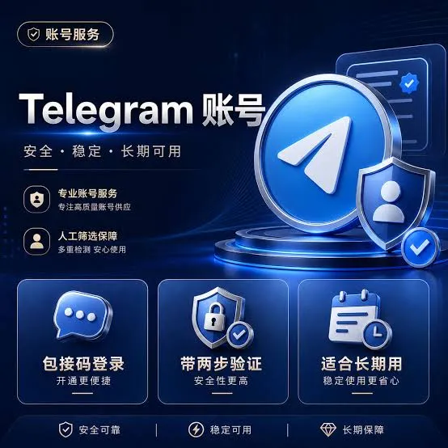

打开手机应用商店，搜索"Telegram"，你会看到它被归类为即时通讯应用。但如果你用过微信、WhatsApp或者iMessage，可能会好奇：Telegram和这些软件到底有什么区别？为什么有人把它称为"最注重隐私的通讯工具"？

这篇文章从基础概念出发，把Telegram的核心功能、使用方式、隐私机制以及和主流通讯软件的差异讲清楚。不管你是第一次听说这个名字，还是已经用了但想搞清楚它到底能做什么，都能在这里找到答案。

## Telegram的来历和基本定位

Telegram是由俄罗斯兄弟Nikolai Durov和Pavel Durov在2013年推出的即时通讯应用。Nikolai是前俄罗斯社交平台VKontakte（类似Facebook）的联合创始人，Pavel则是前VKontakte的CEO。兄弟俩在离开VK后创立了Telegram，目标是做一款"更快、更私密"的通讯工具。

从定位上看，Telegram的核心卖点是**速度**和**隐私**。它的数据存储在云端，不像微信那样把聊天记录存在本地。这意味着你可以在任何设备上登录，历史记录会自动同步。同时，Telegram提供端到端加密的"秘密聊天"模式，这是它区别于其他通讯软件的关键功能。

截至2024年，Telegram的月活跃用户数已超过9亿，是全球使用人数最多的通讯应用之一。它在欧洲、中东、东南亚等地区尤其流行，在俄罗斯更是几乎成为国民级应用。

## Telegram的核心功能有哪些

### 消息和群组

Telegram支持文字、图片、视频、语音、文件等多种消息类型。文件传输方面，普通用户最大可以发送2GB的文件，这在同类软件中属于非常宽松的限制。

群组功能是Telegram的一大亮点。普通群组最多支持20万人，频道则没有人数上限。管理员可以设置权限、置顶消息、开启话题讨论等功能。很多新闻媒体、博主、社区都通过Telegram频道来发布内容。

### 频道和机器人

频道是Telegram上类似"公众号"的功能。发布者可以单向推送消息，订阅者只能接收。很多大型信息源——从加密货币行情到学术论文速递——都通过频道分发内容。

机器人则是Telegram的另一个特色。开发者可以创建自定义机器人，实现自动回复、定时推送、投票统计、文件转换等各种功能。Telegram的Bot API对开发者非常友好，生态相当丰富。

### 语音和视频通话

Telegram支持一对一和群组语音/视频通话。秘密聊天模式下的通话采用端到端加密，普通通话则使用SRTP协议进行传输加密。

### 多设备同步

Telegram的云端存储模式意味着你可以在手机、电脑、平板上同时登录同一个账号。所有消息、媒体文件、设置都会自动同步。这和微信的"手机为主、电脑为辅"的逻辑完全不同。

## Telegram的隐私机制：到底有多安全

隐私是Telegram最受关注的卖点，但实际情况比宣传要复杂一些。

### 普通聊天的加密方式

普通聊天（即默认的消息模式）使用**传输层加密**（TLS），消息在传输过程中是加密的，但到达Telegram服务器后会解密存储。这意味着Telegram服务器理论上可以访问你的普通聊天内容。

### 秘密聊天的端到端加密

开启"秘密聊天"后，消息采用**端到端加密**（E2EE）。只有发送方和接收方的设备能解密消息，Telegram服务器无法读取内容。秘密聊天还支持自毁消息、屏幕截图通知、禁止转发等功能。

不过需要注意的是，秘密聊天**不支持多设备同步**。你在手机上发起的秘密聊天，在电脑上无法查看。这是端到端加密带来的固有限制。

### 服务器和数据中心

Telegram的服务器主要部署在欧洲、美国、新加坡等地。它不依赖云服务商（如AWS或Google Cloud），而是自建数据中心，声称对数据有完全的控制权。但这一说法在安全社区中存在争议，因为"自建服务器"并不意味着更高的安全性。

## Telegram和微信、WhatsApp、Signal的对比

| 特性 | Telegram | 微信 | WhatsApp | Signal |
|------|----------|------|----------|--------|
| 端到端加密 | 仅秘密聊天 | 默认开启 | 默认开启 | 默认开启 |
| 云端存储 | 支持 | 不支持 | 支持 | 不支持 |
| 群组人数上限 | 20万人 | 1000人 | 256人 | 无明确上限 |
| 频道功能 | 支持 | 公众号 | 不支持 | 不支持 |
| 文件传输上限 | 2GB | 无明确限制 | 100MB | 100MB |
| 多设备同步 | 完全同步 | 以手机为主 | 支持 | 有限支持 |
| 机器人生态 | 丰富 | 有限 | 有限 | 无 |

从这张表可以看出，Telegram的定位非常独特。它在隐私方面不如Signal和WhatsApp（后两者默认端到端加密），但在功能丰富度、群组规模和文件传输方面远超其他应用。

## 在中国使用Telegram需要注意什么

Telegram在中国大陆被封锁，无法直接访问。这意味着国内用户需要使用特定的网络环境才能正常使用。

### 网络访问问题

由于网络限制，Telegram在中国大陆无法直接连接。部分用户通过配置网络代理来访问，但需要注意：

- 使用不稳定的代理可能导致消息发送延迟或丢失

- 频繁切换网络环境可能触发Telegram的风控机制

- 部分地区的网络环境可能影响语音和视频通话质量

### 手机号注册

Telegram使用手机号作为注册和验证的唯一方式。国内手机号可以正常注册，但在验证环节可能会遇到短信延迟或无法接收的情况。如果遇到验证码问题，可以尝试：

- 等待几分钟重新发送验证码

- 切换到语音通话验证方式

- 确认手机信号和短信接收功能正常

- 检查是否被运营商拦截了国际短信

### 数据存储位置

Telegram的服务器不在中国境内，这意味着你的聊天数据存储在境外服务器上。对于普通用户来说，这通常不是问题。但如果涉及敏感信息，需要了解数据跨境存储的相关法规。

## Telegram适合哪些人使用

Telegram并不是适合所有人的通讯工具。它的最佳使用场景包括：

**需要大文件传输的用户**：2GB的文件传输上限让Telegram成为设计师、开发者、视频创作者传输大文件的利器。

**需要大群聊的社区运营者**：20万人的群组上限和频道功能，让Telegram成为社区管理的首选工具。

**注重隐私但需要多设备同步的用户**：秘密聊天提供端到端加密，同时不影响你在其他设备上的正常使用。

**加密货币和Web3社区**：大量加密货币项目通过Telegram进行社区运营，机器人和频道功能在加密领域被广泛使用。

**海外华人**：很多海外华人使用Telegram与国内的亲友联系，尤其是在微信被某些国家限制的情况下。

## 常见问题

**Telegram是免费的吗？**

是的，Telegram的基础功能完全免费。它通过可选的订阅服务（Telegram Premium）盈利，付费用户可以享受更大的文件传输上限、更快的视频下载速度、语音消息转文字等额外功能。

**Telegram会读取我的聊天记录吗？**

普通聊天的消息会存储在Telegram服务器上，理论上可以被访问。秘密聊天的消息采用端到端加密，Telegram无法读取。如果你非常在意隐私，建议对重要对话使用秘密聊天模式。

**Telegram支持中文吗？**

支持。Telegram的界面支持中文显示，你可以在设置中切换语言。同时，Telegram上也有大量中文频道和群组，中文用户群体相当活跃。

**注销Telegram账号后会怎样？**

注销账号后，你的所有消息、媒体文件和群组会被删除。如果账号30天内没有登录，Telegram也会自动删除该账号。

**Telegram可以恢复已删除的消息吗？**

普通聊天的消息，如果发送方删除，接收方也会收到删除提示（取决于设置）。秘密聊天的自毁消息一旦过期，无法恢复。

## 总结

Telegram是一款功能丰富、注重隐私的即时通讯软件。它的云端同步、大群组、频道和机器人生态构成了独特的产品优势。在隐私方面，普通聊天和秘密聊天采用不同的加密策略，用户需要根据自身需求选择合适的聊天模式。

如果你需要一款速度快、功能多、支持大文件传输和大群组的通讯工具，Telegram值得尝试。但如果你追求的是"默认端到端加密"的隐私保护，Signal可能是更合适的选择。

选择通讯工具没有绝对的对错，关键是看它是否满足你的实际使用需求。
