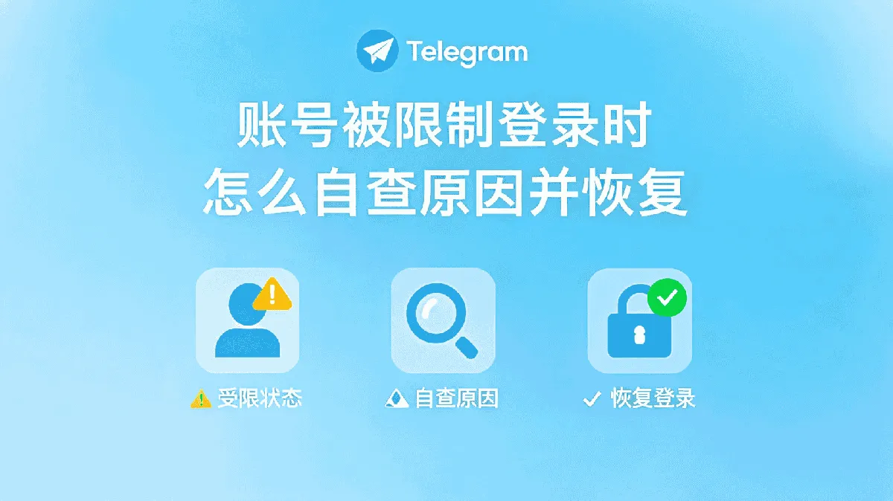

打开Telegram准备扫码，却发现找不到扫码入口——这是不少用户第一次使用扫码功能时遇到的困惑。Telegram的扫码功能覆盖加好友、登录验证、身份确认等多个场景，但不同场景下的操作路径并不相同。下面把常见情况逐一说明清楚。

## Telegram扫码的几种常见场景

Telegram里的扫码不是单一功能，而是分布在不同入口的多个操作。了解这些场景，才能找到对应的入口。

**扫码加好友**是最常见的需求。用户在公开渠道（论坛、群聊、线下活动）看到别人的Telegram二维码，需要扫描后添加对方为好友。

**扫码登录**适用于你在一台新设备上已经登录过Telegram，想快速在新设备或新浏览器上验证身份，而不需要重新接收短信验证码。

**扫码身份验证**出现在部分官方验证流程中，比如绑定手机号后需要扫码确认，或者在Telegram Passport等身份认证服务中使用。

**扫码进入群组或频道**，部分群主会生成群组二维码，成员扫码即可直接加入，无需搜索群号。

## 扫码加好友的具体操作步骤

加好友是大多数用户第一次接触Telegram扫码的目的。操作路径因手机端和电脑端而异。

### 手机端扫码加好友

打开Telegram手机端应用，点击右下角的铅笔图标（Android）或右上角的铅笔图标（iOS），进入"新建"菜单。在菜单中找到"扫描二维码"选项，点击后摄像头会自动启动。

将摄像头对准对方的二维码，保持手机稳定。识别成功后，屏幕会显示对方的用户资料。点击"添加好友"按钮即可完成添加。

如果对方设置了隐私权限，限制陌生人添加好友，你发送的请求会被对方收到，但需要对方手动同意。

### 电脑端扫码加好友

在Telegram桌面版（Windows/Mac）中，点击左侧边栏的"搜索"图标，切换到"二维码"标签页，即可显示你自己的二维码。但如果你需要扫描别人的二维码，桌面版本身不支持直接调用摄像头扫码。

解决办法是先用手机端扫描并添加好友，或者让对方把二维码截图发给你，在桌面版中通过"从图片添加"的方式导入。部分桌面版版本支持在聊天窗口中右键选择"扫描二维码"，但这取决于具体版本。

### 浏览器版扫码

在Telegram Web（web.telegram.org）上，点击右上角菜单，找到"扫描二维码"选项。浏览器会请求摄像头权限，授权后即可扫描对方的二维码添加好友。

## 用Telegram扫码登录的方法

扫码登录适合你已经在手机Telegram上登录了账号，现在需要在电脑或另一台设备上快速登录的情况。这种方式比接收短信验证码更快，也避免了验证码延迟的问题。

### 电脑端扫码登录步骤

打开Telegram桌面版，在登录页面选择"通过手机登录"。屏幕会显示一个二维码。

打开手机Telegram，点击左上角菜单（三横线图标），选择"设置" → "设备" → "扫描二维码"。扫描电脑屏幕上显示的二维码，手机确认后电脑端即完成登录。

### 浏览器版扫码登录

访问Telegram Web，在登录页面选择"使用手机登录"。同样会出现一个二维码，用手机Telegram扫描即可。

### 扫码登录的前提条件

扫码登录有一个关键前提：你的手机端Telegram必须已经处于登录状态，且开启了"设备管理"功能。如果手机端未登录或网络异常，扫码操作将无法完成。

另外，部分账号如果开启了"两步验证"（双重验证），扫码登录后可能还需要输入密码，这是正常的额外安全验证。

## 扫码时常见问题和解决方法

### 扫码后没有反应

这种情况通常是因为摄像头权限未开启。在系统设置中找到Telegram应用，确认"摄像头"权限已开启。如果权限已开启但依然无法扫描，尝试重启应用或清除缓存。

另一个常见原因是二维码图片质量太差。如果对方分享的是截图或转发的二维码，可能分辨率不足导致识别失败。让对方重新生成一个清晰的二维码，或者直接使用对方用户名搜索添加。

### 扫码后提示"用户未找到"

这说明对方的二维码可能已经过期，或者对方已经注销了账号。Telegram的二维码是动态生成的，有时效性。让对方重新生成一个新的二维码再试。

### 扫码后无法添加好友

如果对方设置了隐私权限中的"谁可以添加我为好友"为"我的联系人"，而你不在对方的通讯录中，扫码后虽然能识别用户，但无法发送添加请求。这种情况下只能让对方主动添加你，或者让对方调整隐私设置。

### 扫码登录失败

扫码登录失败的常见原因包括：手机端和电脑端网络不同步、手机端Telegram版本过旧、账号开启了双重验证但未输入密码。逐一排查这些情况通常能解决问题。

## 扫码安全注意事项

扫码功能虽然方便，但也需要注意几个安全细节。

**确认二维码来源。** 在公共场合或网络环境中，不要随意扫描来路不明的二维码。恶意二维码可能引导你进入钓鱼频道或诈骗群组。

**不要在公共WiFi下扫码登录。** 虽然Telegram使用端到端加密，但扫码登录过程中如果网络环境不安全，理论上存在中间人攻击的风险。建议在可信网络环境下完成登录操作。

**定期检查已登录设备。** 在"设置" → "设备"中可以查看所有已登录的设备。如果发现不认识的登录记录，立即点击"注销所有设备"。

**保护你的二维码。** 你的个人二维码等同于你的账号入口。不要随意分享给他人，更不要发布在公开平台上。

## 扫码功能在不同版本中的差异

Telegram更新频繁，扫码功能的位置和名称在不同版本中可能有所不同。以下是几个版本的差异点：

- **Android旧版本（4.x之前）**：扫码入口在"新建"菜单中，图标为二维码样式。

- **Android新版本（8.x及以后）**：扫码入口在左上角菜单 → "设置" → "隐私和安全" → "二维码"。

- **iOS版本**：扫码入口在"新建"菜单中，名称为"扫描二维码"。

- **桌面版**：部分版本在搜索栏切换标签页，部分版本在菜单中。

如果找不到扫码入口，建议先更新Telegram到最新版本。

## 常见问题

**Telegram扫码需要翻墙吗？**
扫码功能本身不依赖特定网络，但Telegram在中国大陆无法直接访问。如果你无法打开Telegram应用，扫码功能自然也无法使用。

**二维码可以转发给别人扫描吗？**
可以，但需要注意时效性。Telegram的二维码通常包含时效信息，过期后需要重新生成。另外，转发过程中图片可能被压缩，影响识别率。

**扫码添加好友后对方看不到我？**
检查对方的隐私设置。如果对方将"谁可以添加我为好友"设置为"我的联系人"，而你的号码不在对方通讯录中，对方不会收到你的添加请求。

**扫码登录和手机验证码登录有什么区别？**
扫码登录利用已登录设备的信任关系完成验证，速度更快，不需要等待短信。手机验证码登录适用于全新设备或手机端未登录的情况，但可能遇到验证码延迟问题。

**扫码功能在Telegram Premium中有什么额外功能？**
Premium会员的扫码功能与普通用户基本一致，但Premium用户享有更大的文件上传限制和更快的下载速度，这些与扫码功能无直接关系。
