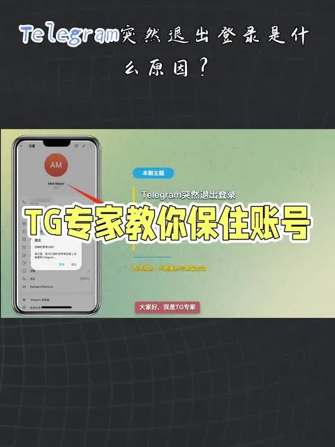

在使用 Telegram（简称 TG）时，很多用户为了在电脑上更方便地聊天，会选择电脑客户端。相比于输入手机号并等待验证码的繁琐步骤，TG 提供了非常便捷的“扫码登录”功能。这是目前最快速且安全的登录方式之一。本文将为你详细介绍 TG 怎么扫码登录的具体步骤，以及在过程中可能遇到的问题及解决方法。

## 一、 TG 扫码登录的准备工作

在开始扫码登录之前，请确保你满足以下三个条件：
1. **手机端已登录**：你的手机 Telegram App 必须已经处于登录状态。
2. **电脑端已安装官方版客户端**：你已经在电脑上下载并安装了官方的 Telegram Desktop 客户端（Windows, macOS 或 Linux 版本均可）。
3. **网络环境畅通**：手机和电脑端都必须能够正常连接 TG 服务器，否则二维码将无法生成或失效。

## 二、 TG 扫码登录详细步骤

扫码登录的操作非常简单，按照以下流程操作即可：

### 第一步：打开电脑端登录界面

在电脑上启动 Telegram 客户端。如果你是首次安装，你会看到一个巨大的二维码；如果之前登录过其他账号，需要先点击“Log Out”（退出）。

### 第二步：在手机端开启扫描功能

1. 打开手机上的 Telegram App。
2. 点击右下角的 **Settings（设置）**（Android 用户点击左上“三条线”菜单）。
3. 找到 **Devices（设备）**选项。
4. 点击右上角的 **Link Desktop Device（关联桌面设备）**。

### 第三步：扫描二维码

此时手机摄像头会对准电脑屏幕上的二维码。手机会自动识别二维码信息。

### 第四步：确认登录

识别成功后，手机端会弹出一个窗口，询问你是否允许该设备登录。点击 **Link（关联）** 即可。片刻，你的电脑端会立即同步所有的聊天记录、联系人和群组，登录完成。

## 三、 扫码登录失败怎么办？常见问题及解决方法

在操作过程中，有些用户可能会遇到二维码无法识别或登录失败的情况，以下是几种常见问题的解决方案：

### 1. 二维码一直旋转或无法显示

- **原因**：网络连接不稳定或电脑端版本过旧。

- **解决方法**：检查电脑端的网络环境，确保可以正常访问 TG 服务。同时尝试将 Telegram Desktop 更新到最新版本。

### 2. 手机扫描二维码后没反应

- **原因**：电脑屏幕反光过强、亮度太低，或者手机摄像头权限未开启。

- **解决方法**：调整电脑屏幕亮度，避免产生严重反光。检查手机设置，确保已允许 Telegram 访问相机权限。

### 3. 提示“需要输入验证码”

- **原因**：这通常是因为安全策略触发，或者你是在新的设备上登录，需要额外的身份验证。

- **解决方法**：点击电脑端下方的“Log in by phone number”（手机号登录），手动输入手机号，通过手机端 TG 内部的消息框获取验证码进行登录。

### 4. 二维码已失效

- **原因**：TG 的二维码具有时效性，长时间未被扫描会失效。

- **解决方法**：点击电脑屏幕上的刷新按钮，生成新的二维码重新扫描。

## 四、 安全提示：保护你的账号

虽然扫码登录非常方便，但为了账号安全，请务必注意以下几点：
 **不要在公共电脑上登录**：在网吧或公共场所使用扫码登录后，离开前请务必点击 Log Out。
 **开启双重验证（2FA）**：建议在手机设置的 `Privacy and Security > Two-step verification` 中开启密码，这样即使别人获取了你的验证码，没有密码也无法登录账号。
 **定期检查设备列表**：定期在手机端的 `Devices` 页面查看是否有异常登录设备，如果发现不是自己的设备，立即点击 `Terminate Session` 强制下线。

通过以上教程，你应该已经掌握了 TG 怎么扫码登录的方法。这种方式不仅高效，还能避免短信验证码延迟或被拦截的风险。

