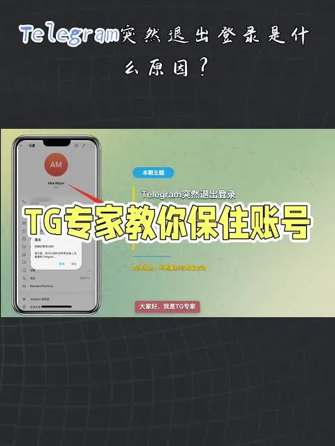

在如今的社交通讯领域，Telegram（简称电报）已成为许多人进行跨境交流、信息获取的首选工具。无论是为了营销、加入社群还是为了隐私保护，一个稳定的Telegram账号都是必不可少的。然而，市面上充斥着各种tg账号交易平台，良莠不齐，很多新手在交易时极易遭遇诈骗、封号或账号被回等问题。本文将从账号类型、平台筛选标准以及交易风险防控等维度，帮助你更安全地进行账号交易。

## 为什么人们需要tg账号交易平台？

虽然用户可以通过手机号自行注册账号，但在实际使用中，往往会遇到以下痛点：

1. **注册环境受限**：部分地区的手机号段无法接收验证码，或者由于IP环境问题，注册后频繁提示“操作频繁”。
2. **账号权重需求**：新注册的账号在加入大型群组或发送消息时容易被系统判定为营销号。很多用户需要购买经过长期运营、权重较高的“老号”。
3. **隐私保护需求**：部分用户不希望使用真实的个人手机号绑定账号，倾向于使用虚拟号或海外接码平台。
4. **批量操作需求**：对于营销从业者而言，手动注册账号的效率极低，需要通过平台批量获取成品号。

## 常见的tg账号类型及其差异

在进入交易平台之前，你必须明确市面上常见的账号类型，这直接决定了你的使用成本和稳定性：

- **虚拟号账号**：通过虚拟平台（如Google Voice等）注册的账号。优点是便宜，缺点是不稳定，一旦虚拟号被回收或平台封禁号段，账号极易丢失且无法找。

- **实体卡账号**：使用真实的SIM卡注册的账号。稳定性最高，不容易被封号，但成本相对较高，且涉及隐私风险。

- **老号（权重号）**：注册时间较长的账号。这类账号在系统算法中信任度较高，适合用于高频的营销活动或群组操作。

- **成品号**：指已经注册好、配置好基础信息（如头像、用户名）的账号，购买后直接登录即可使用。

## 如何判断一个tg账号交易平台是否可靠？

面对琳琅满目的网站，建议通过以下几个维度进行深度筛选：

### 1. 交易流程的自动化程度

可靠的平台通常拥有完善的自动发货系统。下单支付后，系统自动提供账号、密码及对应的验证码。如果一个平台需要长时间人工客服对单，且支付方式极其单一，建议保持极高警惕。

### 2. 售后保障机制

这是判断平台好坏的核心。优质的平台会提供“售后包”服务，例如：在登录后的24小时或48小时内，如果是非质量封号，支持补发或退款。如果承诺“无售后”，那么交易风险极高。

### 3. 用户口碑与社区反馈

在社交平台或专业垂直论坛搜索该平台的评价。注意，不要只看官网自刷的好评，要关注真实用户反馈的封号率和客服响应速度。

### 4. 支付方式的多样性

正规平台通常支持主流的支付渠道。如果仅要求通过特定的个人转账或难以追踪的加密货币支付，往往是钓鱼行为的信号。

## 交易过程中的风险与防范措施

即便选择了看似靠谱的平台，交易过程本身仍存在风险，请务必遵循以下操作：

- **立即开启两步验证（2FA）**：登录账号后的第一件事就是进入设置，开启两步验证并设置复杂的密码。这样即使对方再次获取了你的验证码，没有你的2FA密码也无法登录。

- **更换登录环境**：不要在多个不同的IP之间频繁切换登录，这会触发Telegram官方的安全风控机制。建议使用固定且干净的代理节点。

- **避免初期过度操作**：新购买的账号切忌在短时间内大量加入群组或发送大量广告信息。建议先进行正常的聊天，通过“养号”逐步提升账号权重。

- **保护个人隐私**：如果是购买虚拟号账号，尽量不要绑定自己真实的私人邮箱，防止邮箱泄露导致二次风险。

## 总结

tg账号交易平台是一个提升效率的工具，但也是一把双刃剑。用户应当根据自己的实际需求（是普通聊天还是商业营销）来选择合适的账号类型，并优先选择有售后保障、口碑良好的平台。在交易过程中，安全意识永远第一，切勿贪图廉价而忽视了账号的稳定性与安全性。
