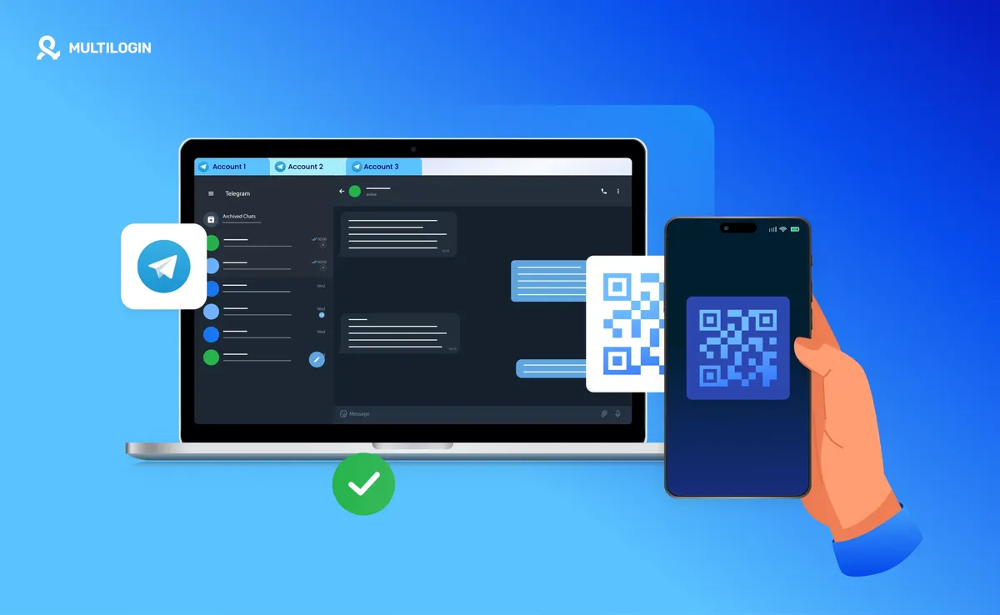

在更换设备或在电脑端首次登录 Telegram 时，很多用户会发现，相比于输入手机号并等待短信验证码，手机tg扫码登录是一种更快捷、更安全的方式。这种登录方式规避了短信验证码收不到或延迟的尴尬，极大地缩短了登录时间。然而，许多用户在实际操作过程中，会遇到二维码不显示、扫描失败或登录后频繁报错等问题。本文将详细介绍手机扫码登录的具体流程，并针对常见异常提供解决方案。

## 手机tg扫码登录的原理与优势

扫码登录的本质是利用已登录设备（通常是手机端）对新设备（如电脑版客户端或新手机）进行授权。当你在设备上请求登录时，系统会生成一个动态的二维码，你只需在已登录的 Telegram 手机中扫描该二维码，即可完成身份验证。

相比传统的手机号验证码登录，扫码登录具有以下显著优势：
1. **规避短信风控**：很多地区的用户在接收短信验证码时经常会出现收不到或验证码过期的情况，扫码登录完全不依赖短信通道。
2. **安全性更高**：授权过程在两个设备之间直接完成，减少了验证码被拦截或被钓鱼网站的风险。
3. **操作极简**：无需手动输入复杂的手机号和验证码，对准摄像头即可进入账号。

## 如何在电脑端使用手机扫码登录 Telegram

如果你是想在 Windows、macOS 或 Linux 版本的 Telegram 客户端上登录，可以按照以下步骤进行扫码操作：

### 第一步：在电脑端生成二维码

在电脑上下载并打开 Telegram 客户端。在登录界面，你会看到一个巨大的二维码。如果界面显示的是手机号输入框，请点击“Log in as phone number”切换回扫码登录模式。

### 第二步：在手机端开启扫描功能

拿起你已经登录了 Telegram 的手机：
1. 点击左下角的“Settings”（设置）。
2. 找到“Devices”（设备）。
3. 点击右上角的“Link Desktop Device”（连接桌面设备）。

### 第三步：完成授权

将手机摄像头对准电脑屏幕上的二维码。此时手机端会弹出一个确认框，询问你是否允许该新设备登录。点击“Confirm”或“确认”，电脑端便会自动刷新并进入聊天界面。

## 手机扫码失败或没反应怎么办？

在实际操作中，用户经常会遇到二维码无法识别或扫描后手机长时间没反应的情况。这通常由以下几个原因导致：

### 网络环境不稳定

这是最常见的原因。如果电脑端的网络无法正常连接到 Telegram 服务器，二维码可能无法实时刷新，或者扫描后请求无法发送。请确保你的手机和电脑都处于良好的网络环境下，且可能需要合适的科学上网工具。

### 二维码过期

二维码是有时效性的，通常几分钟的有效期。如果你在生成二维码后过久才去扫描，二维码就会失效。此时只需点击电脑上的刷新按钮重新生成即可。

### 手机端版本过旧

如果你的手机端 Telegram 版本太低，可能不支持最新的设备管理或扫描授权功能。建议前往应用 Store 或 Google Play 确保应用已到最新版本。

## 如果没有已登录的设备如何登录？

如果你换了新手机，且旧手机丢失，导致没有任何设备处于登录状态，那么你无法使用“扫码登录”。在这种情况下，你只能回归传统的手机号登录方式。

### 手机号登录的注意事项

1. **选择国家代码**：确保地区选择正确（如中国对应 +86）。
2. **等待应用内验证**：Telegram 默认会把验证码发送到你其他在线的设备上（如电脑端）。如果没有其他设备，点击页面下方的“Get the code via SMS”，系统才会尝试发送短信。
3. **双重验证密码**：如果你之前开启了“两步验证”（Two-Step Verification），在输入短信验证码后，还需要输入设置的额外密码。

## 账号安全：登录后的后续维护建议

无论你是通过扫码登录还是手机号登录，账号安全都是重中之重。登录成功后，建议养成以下习惯：

### 开启双重验证 (2FA)

强烈建议在 `Settings > Privacy and Security > Two-Step Verification` 中设置额外的密码。这样即使别人获取了你的手机验证码或拦截了短信，没有这个密码也无法进入你的账号。

### 定期检查登录设备列表

定期在手机端的 `Devices` 设置中查看当前登录的设备。如果发现有不属于自己的设备或异常登录地，立即点击“Terminate all other sessions”（终止所有其他会话），以踢出可疑设备。

### 保护授权二维码

永远不要在非官方的第三方网页上扫描任何 Telegram 二维码。官方的扫码登录只会出现在 Telegram 的官方客户端或官方网页版界面中。

## 常见问题 FAQ

**Q：扫码后电脑端显示“Internal Error”怎么办？**
A：这通常是由于网络连接不稳定导致的。请尝试切换网络节点，或者检查你的代理设置是否能够正常访问 Telegram 服务器。

**Q：可以用手机扫码登录到另一台手机吗？**
A：不可以。扫码登录的前提是你必须已经有一台处于登录状态的设备。如果是新手机登录旧账号，必须通过手机号+验证码的方式进行。

**Q：扫码时手机没有弹出确认框？**
A：请检查手机端是否已经点击了“Devices”里的“Link Desktop Device”。如果没有进入这个扫描模式，摄像头是不会识别二维码的。
